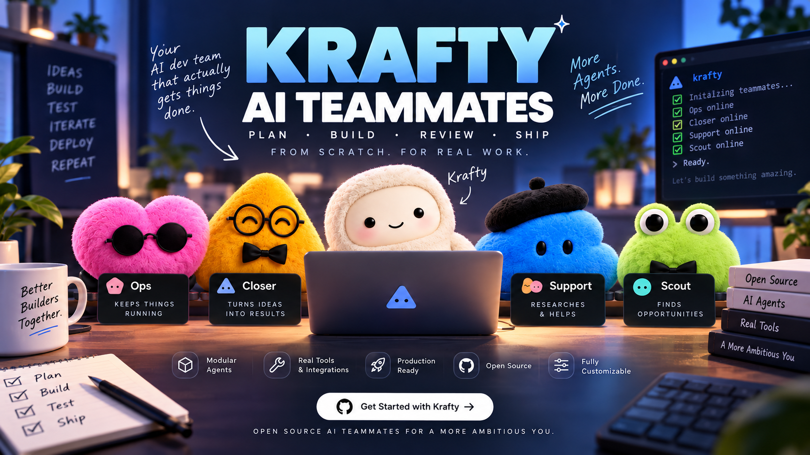
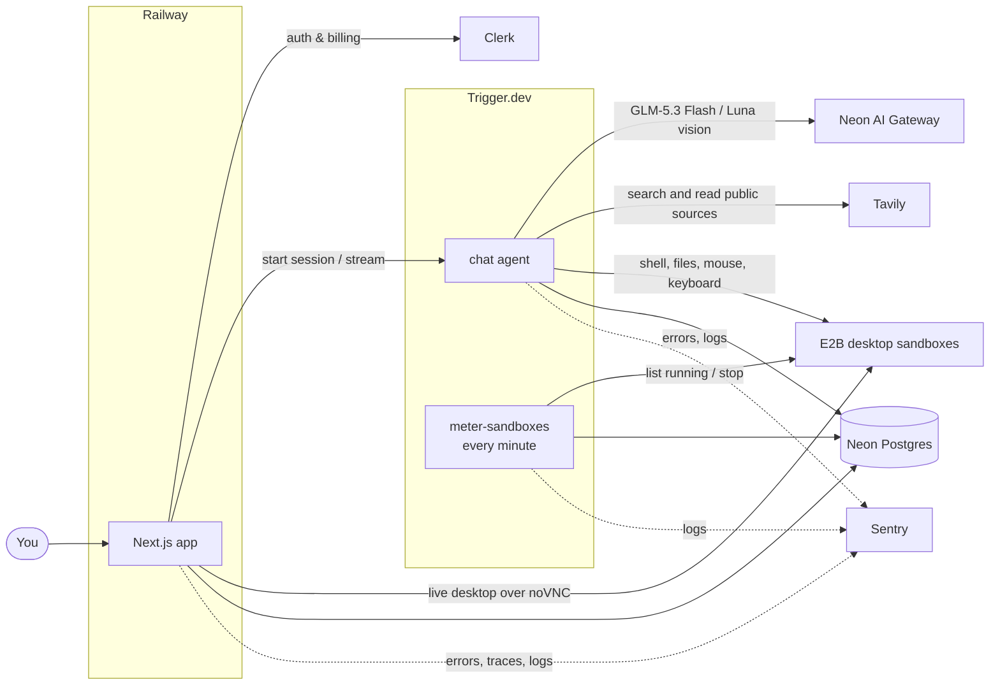

<div align="center">



### The open-source alternative to Grok Bot, OpenAI Dots and Meta Muse

AI teammates with a job, a memory and a cloud computer of their own.

[](https://cwa.run/trigger-1)
[](https://e2b.dev)
[](https://cwa.run/firecrawl)
[](https://cwa.run/clerk)
[](https://cwa.run/sentry)
[](https://cwa.run/neon)
<a href="https://railway.com/deploy/ai-teammates?referralCode=ANTONIO&utm_medium=integration&utm_source=template&utm_campaign=generic"></a>

</div>

---

2026 is the year AI stopped being a chat box and became a coworker. Grok Bot, OpenAI Dots and Meta Muse all landed on the same idea: an always-on agent with a computer of its own that does the work instead of describing it. They are also closed.

Krafty is an open exploration of that idea. Every prompt, tool and limit is a file in this repository, with auth, billing, usage metering and observability already in place, so you start from a working product and change whatever you like.

## ✨ Features

- 🧑‍💼 **Teammates with a job**: a name, a job and instructions that each bot keeps in every conversation.
- 🖥️ **A computer for your team**: one persistent Linux sandbox per account, shared by all your bots, with a shell, a filesystem and a graphical desktop (`lib/account-computer.ts`).
- 👀 **Live desktop view**: watch a bot move the mouse and type, streamed into the chat.
- 👥 **Group chats with handoffs**: a bot passes a request to the teammate whose job it is.
- **Expressive teammate avatars**: thinking, tool work, response writing, and questions reflect live chat activity. Handoffs animate the current author, with restrained motion, accessible status text, and reduced-motion support.
- **Composer shortcuts and mentions**: type `/` for research, planning, review, summaries, and task handoffs. Use `@` to find your bots across chats by name or role. `/ask @teammate question` brings back their advice from their profile, recent direct chat, and available memory; `/delegate @teammate task` hands over execution. `/help` explains the shortcuts without spending AI credits.
- **Bots that build the team**: a teammate can create a specialist, give it a complete task brief, and open its chat. It can also assemble groups with existing and new teammates.
- **Connected apps**: browse Composio's live catalog in the Apps dialog, connect accounts, and let teammates discover and use their tools.
- **Built-in web research**: Tavily search and page reading with source links, news/date/domain filters, and instructions to verify and cite current information. Available on free and paid plans when configured.
- 🧠 **Memory across chats**: notes a bot saves in one conversation are there in all the others.
- ♾️ **Durable turns**: a long desktop task survives refreshes, redeploys and closed tabs.
- 💳 **Plans and usage limits**: subscriptions, with model spend and sandbox hours metered per billing period. Chats show how much is left once an allowance drops to a fifth, before it runs out.
- **Copy and export**: copy any reply as Markdown, or download a whole direct or group chat as a Markdown transcript from the chat header.

## 🧱 Built with

| Product                                      | What it does here                                                                             |
| -------------------------------------------- | --------------------------------------------------------------------------------------------- |
| [**Trigger.dev**](https://cwa.run/trigger-1) | Runs the durable chat agent and the cron tasks that meter running sandboxes and start routines. |
| [**E2B Hobby**](https://e2b.dev/pricing)     | One cloud computer per account, shared by its bots: shell, files and a desktop.               |
| [**Clerk**](https://cwa.run/clerk)           | Authentication, plus Billing for plans, checkout and feature gates.                           |
| [**Neon**](https://cwa.run/neon)             | Serverless Postgres, and the AI Gateway the chat model is called through.                     |
| [**Sentry**](https://cwa.run/sentry)         | Errors, traces, session replays and logs from the app and every task run.                     |
| [**Railway**](https://cwa.run/railway)       | Hosts the Next.js app in production.                                                          |
| [**Tavily**](https://tavily.com)             | Built-in public web search and page extraction for the bots.                                  |
| [**Firecrawl**](https://cwa.run/firecrawl)   | Web search and scraping for the coding agent this project is developed with, through its CLI. |

Plus Next.js 16, React 19, AI SDK 7, shadcn/ui, Tailwind CSS 4, Drizzle ORM and DiceBear.

## 🔍 How it works



- **A chat turn** (`trigger/chat.ts`) builds the bot's instructions from its job and streams a reply with the sandbox tools attached (`lib/sandbox-tools.ts`). It stops after 50 steps or when the allowance is spent.
- **The models** (`lib/model.ts`) use GLM-5.3 Flash for text and tools, and GPT-5.6 Luna for steps containing images, through Neon AI Gateway. Both use low reasoning effort. Standard rates per million tokens are $0.15 input / $0.50 output for GLM and $0.20 input / $1.20 output for Luna. Usage is metered per step, including cached input and Luna's long-context tier; current rates are published in [Neon's model catalog](https://neon.com/models.json).
- **In a group chat** the bot also gets a `handoff` tool, which gives the rest of the turn to a teammate. A request cannot bounce back to a bot that already held it.
- **Across chats**, `listTeammates`, `createTeammate`, `delegateToTeammate`, and `createGroupChat` let bots route work to the right role. The destination receives a complete brief and starts on the server before navigation. Destination IDs are stable per user message, and Trigger.dev atomically starts the destination session with its first message. Replaying that operation does not send a second task. Automatic delegation is limited to three hops; a new human message starts a new chain. Groups support two to eight members, and teams are capped at 50 bots. Creating a specialist uses the existing paid-plan and sandbox allowance.
- **Usage** is an append-only ledger. Model spend is written when a turn completes; sandbox time by a task that charges every running sandbox each minute and stops those of owners who have run out. Limits live in `lib/billing-policy.ts`: free accounts get a one-time $1 AI allowance, one bot, and one connected app. Paid accounts get $10 AI usage and 50 computer hours per billing period. Free accounts can chat and use connected-app tools; computers and their persistent memory/files require paid access. Free credit uses lifetime usage, so deleting a bot or changing subscriptions never replenishes it. Bot creation and app authorization are serialized per user, and durable workers recheck access on every turn/tool execution.

## 🚀 Getting started

You need Node.js 24+ and an account with [Clerk](https://cwa.run/clerk), [Neon](https://cwa.run/neon), [Trigger.dev](https://cwa.run/trigger-1) and [E2B](https://e2b.dev). [Sentry](https://cwa.run/sentry) is optional.

**1. Clone and install**

```bash
git clone https://github.com/code-with-antonio/ai-teammates.git
cd ai-teammates
pnpm install
```

**2. Create `.env.local`**

```bash
# Clerk: API keys
NEXT_PUBLIC_CLERK_PUBLISHABLE_KEY=
CLERK_SECRET_KEY=
NEXT_PUBLIC_CLERK_SIGN_IN_URL=/sign-in
NEXT_PUBLIC_CLERK_SIGN_UP_URL=/sign-up
NEXT_PUBLIC_CLERK_SIGN_IN_FALLBACK_REDIRECT_URL=/
NEXT_PUBLIC_CLERK_SIGN_UP_FALLBACK_REDIRECT_URL=/

# Neon: pooled string for the app, direct string for drizzle-kit
DATABASE_URL=
DATABASE_URL_UNPOOLED=

# Neon AI Gateway
NEON_AI_GATEWAY_BASE_URL=
NEON_AI_GATEWAY_TOKEN=

# Optional: Composio project API key for the Apps marketplace and agent tools
COMPOSIO_API_KEY=

# Tavily: server-side public web search and page reading for every bot, including unfinished setup
TAVILY_API_KEY=

# Trigger.dev: the development key and the project ref
TRIGGER_SECRET_KEY=
TRIGGER_PROJECT_REF=

# E2B Hobby (server-side only; no paid plan required)
E2B_API_KEY=

# Optional: Expo access token, if push security is turned on for the Expo
# project. Read where push notifications are sent (app and worker).
EXPO_ACCESS_TOKEN=

# Sign in with Apple token revocation on account deletion (Railway only; the
# worker never reads these). The key is a Sign in with Apple key (Certificates,
# Identifiers & Profiles > Keys, "Sign in with Apple" enabled, primary App ID
# app.kraftybot.mobile), not an App Store Connect API key. Paste the .p8
# contents; \n escapes are accepted. The encryption key is 64 hex characters
# (openssl rand -hex 32). Without them, Apple users get manual removal steps.
# See docs/apple-sign-in-revocation.md.
APPLE_TEAM_ID=
APPLE_SIWA_KEY_ID=
APPLE_SIWA_PRIVATE_KEY=
APPLE_SIWA_CLIENT_ID=app.kraftybot.mobile
APPLE_SIWA_TOKEN_ENCRYPTION_KEY=

# Optional: https URL of the current Android APK (Railway only). /download and
# the sidebar's Get the app dialog offer it, and /download/android redirects to
# it. Without it, Android shows as coming soon.
ANDROID_APK_URL=

# Development only: let the local trigger dev worker run routines. Off by
# default because local development shares production's database.
# KRAFTY_DEV_ROUTINES=1

# Sentry: optional. Without the DSN nothing is reported; the other three
# upload source maps on build
NEXT_PUBLIC_SENTRY_DSN=
SENTRY_ORG=
SENTRY_PROJECT=
SENTRY_AUTH_TOKEN=
```

Web searches and page reads share the AI allowance with model usage. See [web research configuration, behavior, and verification](docs/web-search.md). Configure the Tavily key on both Railway and Trigger.dev production when deploying.

Optional ChatGPT account sign-in and subscription-backed replies are described in [ChatGPT authentication and usage](docs/chatgpt-auth.md). Hosted use requires OpenAI approval and a provisioned OAuth client. Subscription-backed model replies bypass Krafty's AI allowance; web searches and cloud-computer usage retain their existing limits.

**3. Set up billing**

In Clerk, enable Billing and create a user plan with two features, slugged `bots` and `sandboxes`.

**4. Push the schema and run**

```bash
npm run db:push            # create the tables
npm run dev                # terminal 1: Next.js
npx trigger.dev@4.7.4 dev  # terminal 2: Trigger.dev tasks
```

Open [http://localhost:3000](http://localhost:3000), sign up, pick a plan and create your first teammate.

## 🚢 Deployment

The app runs on Railway and the tasks run on Trigger.dev, so there are two things to deploy.

**1. Deploy the app to [Railway](https://cwa.run/railway)**

[](https://railway.com/deploy/ai-teammates?referralCode=ANTONIO&utm_medium=integration&utm_source=template&utm_campaign=generic)

Fill in the variables it asks for. `TRIGGER_SECRET_KEY` is your Trigger.dev **production** key here, not the development one.

**2. Deploy the tasks to Trigger.dev**

```bash
npx trigger.dev@4.7.4 deploy
```

**3. Give the tasks their variables**

Add these to the project's production environment in Trigger.dev:

```bash
DATABASE_URL=
CLERK_SECRET_KEY=
E2B_API_KEY=
NEON_AI_GATEWAY_BASE_URL=
NEON_AI_GATEWAY_TOKEN=
COMPOSIO_API_KEY=

# Optional: only if you use Sentry
NEXT_PUBLIC_SENTRY_DSN=
```

## 🤝 Contributing

Issues and pull requests are welcome. Run `pnpm typecheck` and `pnpm test` before opening one, and lint and format only the files you changed (`pnpm exec eslint <files>`, `pnpm exec prettier --write <files>`). `pnpm format` rewrites many untouched files; see `AGENTS.md`.

---

<div align="center">

Built by [Code With Antonio](https://github.com/code-with-antonio)

<sub>An independent project, not affiliated with or endorsed by xAI, OpenAI or Meta.</sub>

</div>

### E2B computers on Hobby

Use `@e2b/desktop` with E2B's **Hobby** plan. Hobby has a one-hour session limit and $100 of one-time usage credits, not unlimited free compute. Do not upgrade or enable automatic paid usage. Check the remaining credits in the E2B console; exhausted credits must surface as a provider error.

Put `E2B_API_KEY` privately in ignored `.env.local`. Never use a `NEXT_PUBLIC_` variable for it. Set the same key on Railway's `ai-teammates` service, `production`, and the Trigger.dev project's `prod` environment. Keep Railway's production `TRIGGER_SECRET_KEY`; the local development key intentionally differs.

Each account has one desktop sandbox, shared by all of its bots (`lib/account-computer.ts`). New computers are paused immediately after creation (`lib/e2b.ts`). Tools resume the same ID and renew a five-minute idle timeout. Commands can lease longer to finish (at most 630 seconds), then return to the five-minute idle policy. E2B automatically **pauses**, rather than kills, on expiry, with automatic traffic-based resume disabled. Before 55 continuous minutes, tools pause/resume into a new session; a connected viewer pauses and asks for Resume. Files and applications survive; saved memory lives in Postgres, not on the computer (`lib/memory.ts`). Deleting a bot keeps the account computer (`services/bots.ts`); deleting the account removes it (`services/account.ts`).

`pnpm dev` runs `server.ts`; `pnpm build` compiles it to `.server/server.mjs`, and `pnpm start` runs the compiled Next.js server with a same-origin WebSocket gateway and a bounded 384 MiB V8 heap. Keep these start commands on Railway: `next start` alone cannot serve the gateway. Public sandbox traffic is disabled. The gateway verifies Clerk authentication, same origin, direct-chat ownership, feature access and remaining usage, then forwards noVNC with the E2B private ingress token **only on the server**. Closing the screen disconnects the stream and stops renewing its lease. Viewing an open screen counts as active use.

`meter-sandboxes` runs every minute on Trigger.dev. It meters real E2B running sessions in seconds, including a short session already paused between polls. Short row-locked billing transactions and cumulative session counters make retries idempotent; paused time is excluded. Both deployment environments share the same database and E2B account. Schema changes use only `npm run db:push`; development rows are reset when switching providers, with no migrations or backfills.

Cross-worker commands, pause, reset and deletion serialize with session advisory locks on a separate, bounded **direct** Postgres pool. `DATABASE_URL_UNPOOLED` must be present on Railway and Trigger.dev production; `DATABASE_URL` continues serving ordinary application queries. No database transaction stays open during a remote command. Busy operations wait at most ten seconds for a lock; desktop heartbeats skip busy tools and do not shorten their lease or resume a paused/replaced session. Provider control-plane requests have a 15-second deadline. Post-operation maintenance failures are reported without masking a completed command or its original error.

A missing provider computer is reported explicitly. The screen panel offers **Reset computer**, with confirmation that the new computer has none of the previous files or browser sign-ins, for any of the account's bots; conversations and memory stay available (`components/desktop-reset-dialog.tsx`). Temporary provider errors never trigger a reset. Resets recheck provider absence under the account lock, serialize with deletion, and update the account's computer row (`resetAccountComputer` in `lib/account-computer.ts`); durable chat tools look up that ID on every call. Metering processes up to four computers concurrently, isolates individual failures, and completes healthy accounts' quota enforcement before requesting a retry. Newly provisioning computers have a five-minute grace period before orphan cleanup.

Verification: `pnpm lint`, `pnpm typecheck`, `pnpm exec tsx --test tests/sandbox-*.test.ts`, `pnpm build`. `pnpm exec tsx --env-file=.env.local scripts/verify-e2b.ts` creates a real temporary bot, exercises its tools and private stream, verifies explicit and idle pause/resume, and deletes it. It consumes Hobby credits. Screenshots and the JSON report are saved under ignored `.artifacts/e2b/`. Pass an output directory to preserve previous evidence, e.g. `pnpm exec tsx --env-file=.env.local scripts/verify-e2b.ts .artifacts/e2b-hardening`. The live verification also checks independent metering while a tool holds a lease, lock release on failure, absence of long billing transactions, and concurrent explicit resets of a missing computer.

### Connected apps and team delegation

Create a dedicated Composio project and put its `COMPOSIO_API_KEY` in ignored `.env.local`, Railway production, and Trigger.dev production. Use the same project in both services. An absent key leaves normal chat and computer tools available; the Apps dialog explains that connections are not configured. The CLI is useful for developer setup and inspection; app users authorize through Composio's browser flow, not a machine-wide CLI login.

Open **Apps** in the sidebar to search the live catalog, connect accounts, refresh connection status after authorization, and disconnect them. Some apps require custom authentication configured in Composio. Each connection is keyed to the authenticated Clerk user and shared by that user's bots. Agent discovery and execution are restricted to active private connections. Session discovery supplies workflow guidance, pitfalls and schemas; `getAppToolSchema` loads an exact known tool on later approval turns or when discovery omits its schema. Execution validates arguments, rechecks ownership and pins the selected connected account; Composio's extra remote sandbox and in-chat connection management are disabled. Tool results stay bounded, and the agent is instructed to treat external content as data and perform writes only when requested. Drafting and sending have distinct semantics, and uncertain writes require external-state verification before retrying. See [connected-app workflow research and verification](docs/research/composio-tool-workflows.md).

Chat workers end after each turn while preserving the durable session and transcript. The next message resumes on the current deployment, so newly deployed tools and configuration do not stay hidden behind an older suspended worker. Connected-app requests use authenticated app APIs; sandbox SMTP is not a fallback for Gmail. Owned accounts are pinned through session configuration, without the optional multi-account execution selector.

Role matching is model-driven. The bot is instructed to reuse a fitting teammate first, announce specialist creation before acting, and explain failures without claiming success. Successful destination tools end the source turn; the browser opens the destination once that turn completes. Stored handoffs remain clickable and do not redirect when old transcripts load. A group creation failure can leave successfully provisioned specialists available in their direct chats; retrying the same operation reuses their IDs.

Run `pnpm exec tsx --test tests/team-tools.test.ts tests/connector-tools.test.ts tests/connector-session.test.ts` alongside the sandbox tests. `pnpm exec tsx --env-file=.env.local scripts/verify-connector-agent.ts` checks the real chat model against current Composio schemas with simulated email execution; it never sends mail. Live checks should cover an unrelated task creating a specialist, destination work continuing without the browser, group creation with new roles, and a connected service under two different Clerk users. OAuth authorization requires the account owner to complete the provider flow. Deploy the app and Trigger.dev worker together when releasing these changes.
