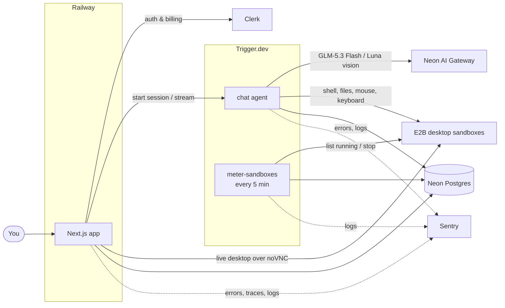

<div align="center">


# AI Teammates

### The open-source alternative to Grok Bot, OpenAI Dots and Meta Muse

AI teammates with a job, a memory and a cloud computer of their own.

[](https://www.youtube.com/watch?v=mQBuZ6Dp0u0)

[](https://cwa.run/trigger-1)
[](https://e2b.dev)
[](https://cwa.run/firecrawl)
[](https://cwa.run/clerk)
[](https://cwa.run/sentry)
[](https://cwa.run/neon)
<a href="https://railway.com/deploy/ai-teammates?referralCode=ANTONIO&utm_medium=integration&utm_source=template&utm_campaign=generic"></a>

</div>

---

2026 is the year AI stopped being a chat box and became a coworker. Grok Bot, OpenAI Dots and Meta Muse all landed on the same idea: an always-on agent with a computer of its own that does the work instead of describing it. They are also closed.

AI Teammates is an open exploration of that idea. Every prompt, tool and limit is a file in this repository, with auth, billing, usage metering and observability already in place, so you start from a working product and change whatever you like.

## 🎬 Watch it being built

[](https://www.youtube.com/watch?v=mQBuZ6Dp0u0)

## ✨ Features

- 🧑‍💼 **Teammates with a job**: a name, a job and instructions that each bot keeps in every conversation.
- 🖥️ **A computer per teammate**: a persistent Linux sandbox with a shell, a filesystem and a graphical desktop.
- 👀 **Live desktop view**: watch a bot move the mouse and type, streamed into the chat.
- 👥 **Group chats with handoffs**: a bot passes a request to the teammate whose job it is.
- 🧠 **Memory across chats**: notes a bot saves in one conversation are there in all the others.
- ♾️ **Durable turns**: a long desktop task survives refreshes, redeploys and closed tabs.
- 💳 **Plans and usage limits**: subscriptions, with model spend and sandbox hours metered per billing period.

## 🧱 Built with

| Product                                      | What it does here                                                                             |
| -------------------------------------------- | --------------------------------------------------------------------------------------------- |
| [**Trigger.dev**](https://cwa.run/trigger-1) | Runs the durable chat agent and the cron task that meters running sandboxes.                  |
| [**E2B Hobby**](https://e2b.dev/pricing)       | One cloud sandbox per bot: shell, files and a desktop it controls.                            |
| [**Clerk**](https://cwa.run/clerk)           | Authentication, plus Billing for plans, checkout and feature gates.                           |
| [**Neon**](https://cwa.run/neon)             | Serverless Postgres, and the AI Gateway the chat model is called through.                     |
| [**Sentry**](https://cwa.run/sentry)         | Errors, traces, session replays and logs from the app and every task run.                     |
| [**Railway**](https://cwa.run/railway)       | Hosts the Next.js app in production.                                                          |
| [**Firecrawl**](https://cwa.run/firecrawl)   | Web search and scraping for the coding agent this project is developed with, through its CLI. |

Plus Next.js 16, React 19, AI SDK 7, shadcn/ui, Tailwind CSS 4, Drizzle ORM and DiceBear.

## 🔍 How it works



- **A chat turn** (`trigger/chat.ts`) builds the bot's instructions from its job and streams a reply with the sandbox tools attached (`lib/sandbox-tools.ts`). It stops after 50 steps or when the allowance is spent.
- **The models** (`lib/model.ts`) use GLM-5.3 Flash for text and tools, and GPT-5.6 Luna for steps containing images, through Neon AI Gateway. Both use low reasoning effort. Standard rates per million tokens are $0.15 input / $0.50 output for GLM and $0.20 input / $1.20 output for Luna. Usage is metered per step, including cached input and Luna's long-context tier; current rates are published in [Neon's model catalog](https://neon.com/models.json).
- **In a group chat** the bot also gets a `handoff` tool, which gives the rest of the turn to a teammate. A request cannot bounce back to a bot that already held it.
- **Usage** is an append-only ledger. Model spend is written when a turn completes; sandbox time by a task that charges every running sandbox each five minutes and stops those of owners who have run out. Limits live in `lib/usage.ts`.

## 🚀 Getting started

You need Node.js 24+ and an account with [Clerk](https://cwa.run/clerk), [Neon](https://cwa.run/neon), [Trigger.dev](https://cwa.run/trigger-1) and [E2B](https://e2b.dev). [Sentry](https://cwa.run/sentry) is optional.

**1. Clone and install**

```bash
git clone https://github.com/code-with-antonio/ai-teammates.git
cd ai-teammates
npm install
```

**2. Create `.env.local`**

```bash
# Clerk: API keys
NEXT_PUBLIC_CLERK_PUBLISHABLE_KEY=
CLERK_SECRET_KEY=
NEXT_PUBLIC_CLERK_SIGN_IN_URL=/sign-in
NEXT_PUBLIC_CLERK_SIGN_UP_URL=/sign-up
NEXT_PUBLIC_CLERK_SIGN_IN_FALLBACK_REDIRECT_URL=/
NEXT_PUBLIC_CLERK_SIGN_UP_FALLBACK_REDIRECT_URL=/

# Neon: pooled string for the app, direct string for drizzle-kit
DATABASE_URL=
DATABASE_URL_UNPOOLED=

# Neon AI Gateway
NEON_AI_GATEWAY_BASE_URL=
NEON_AI_GATEWAY_TOKEN=

# Trigger.dev: the development key and the project ref
TRIGGER_SECRET_KEY=
TRIGGER_PROJECT_REF=

# E2B Hobby (server-side only; no paid plan required)
E2B_API_KEY=

# Sentry: optional. Without the DSN nothing is reported; the other three
# upload source maps on build
NEXT_PUBLIC_SENTRY_DSN=
SENTRY_ORG=
SENTRY_PROJECT=
SENTRY_AUTH_TOKEN=
```

**3. Set up billing**

In Clerk, enable Billing and create a user plan with two features, slugged `bots` and `sandboxes`.

**4. Push the schema and run**

```bash
npm run db:push            # create the tables
npm run dev                # terminal 1: Next.js
npx trigger.dev@4.7.3 dev  # terminal 2: Trigger.dev tasks
```

Open [http://localhost:3000](http://localhost:3000), sign up, pick a plan and create your first teammate.

## 🚢 Deployment

The app runs on Railway and the tasks run on Trigger.dev, so there are two things to deploy.

**1. Deploy the app to [Railway](https://cwa.run/railway)**

[](https://railway.com/deploy/ai-teammates?referralCode=ANTONIO&utm_medium=integration&utm_source=template&utm_campaign=generic)

Fill in the variables it asks for. `TRIGGER_SECRET_KEY` is your Trigger.dev **production** key here, not the development one.

**2. Deploy the tasks to Trigger.dev**

```bash
npx trigger.dev@4.7.3 deploy
```

**3. Give the tasks their variables**

Add these to the project's production environment in Trigger.dev:

```bash
DATABASE_URL=
CLERK_SECRET_KEY=
E2B_API_KEY=
NEON_AI_GATEWAY_BASE_URL=
NEON_AI_GATEWAY_TOKEN=

# Optional: only if you use Sentry
NEXT_PUBLIC_SENTRY_DSN=
```

## 🤝 Contributing

Issues and pull requests are welcome. Run `npm run lint`, `npm run typecheck` and `npm run format` before opening one.

---

<div align="center">

Built by [Code With Antonio](https://github.com/code-with-antonio)

<sub>An independent project, not affiliated with or endorsed by xAI, OpenAI or Meta.</sub>

</div>

### E2B computers on Hobby

Use `@e2b/desktop` with E2B's **Hobby** plan. Hobby has a one-hour session limit and $100 of one-time usage credits, not unlimited free compute. Do not upgrade or enable automatic paid usage. Check the remaining credits in the E2B console; exhausted credits must surface as a provider error.

Put `E2B_API_KEY` privately in ignored `.env.local`. Never use a `NEXT_PUBLIC_` variable for it. Set the same key on Railway's `ai-teammates` service, `production`, and the Trigger.dev project's `prod` environment. Keep Railway's production `TRIGGER_SECRET_KEY`; the local development key intentionally differs.

Each bot has one desktop sandbox. New computers are paused immediately after `MEMORY.md` is initialized. Tools resume the same ID and renew a five-minute idle timeout. Commands can lease longer to finish (at most 630 seconds), then return to the five-minute idle policy. E2B automatically **pauses**, rather than kills, on expiry, with automatic traffic-based resume disabled. Before 55 continuous minutes, tools pause/resume into a new session; a connected viewer pauses and asks for Resume. Files, memory and applications survive. Delete bot permanently kills its sandbox.

`pnpm dev` runs `server.ts`; `pnpm build` compiles it to `.server/server.mjs`, and `pnpm start` runs the compiled Next.js server with a same-origin WebSocket gateway and a bounded 384 MiB V8 heap. Keep these start commands on Railway: `next start` alone cannot serve the gateway. Public sandbox traffic is disabled. The gateway verifies Clerk authentication, same origin, direct-chat ownership, feature access and remaining usage, then forwards noVNC with the E2B private ingress token **only on the server**. Closing the screen disconnects the stream and stops renewing its lease. Viewing an open screen counts as active use.

`meter-sandboxes` runs every minute on Trigger.dev. It meters real E2B running sessions in seconds, including a short session already paused between polls. Transaction locks and cumulative session counters make retries idempotent; paused time is excluded. Both deployment environments share the same database and E2B account. Schema changes use only `npm run db:push`; development rows are reset when switching providers, with no migrations or backfills.

Verification: `pnpm lint`, `pnpm typecheck`, `pnpm exec tsx --test tests/sandbox-policy.test.ts`, `pnpm build`. `pnpm exec tsx --env-file=.env.local scripts/verify-e2b.ts` creates a real temporary bot, exercises its tools and private stream, verifies explicit and idle pause/resume, and deletes it. It consumes Hobby credits. Screenshots and the JSON report are saved under ignored `.artifacts/e2b/`.
